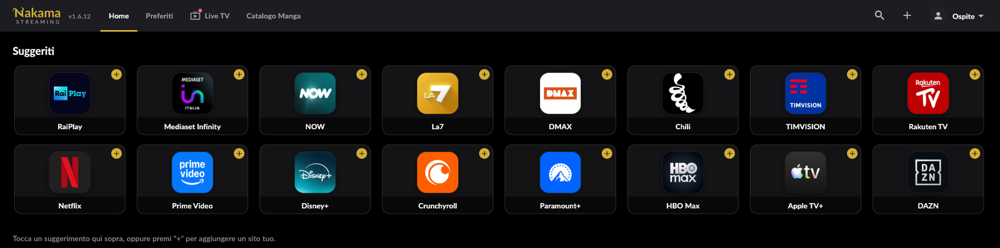
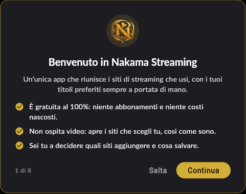
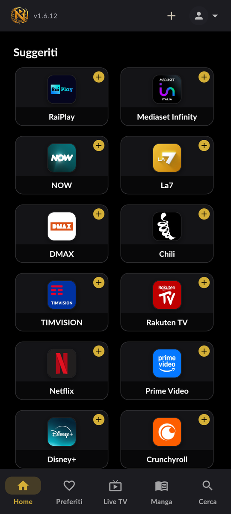
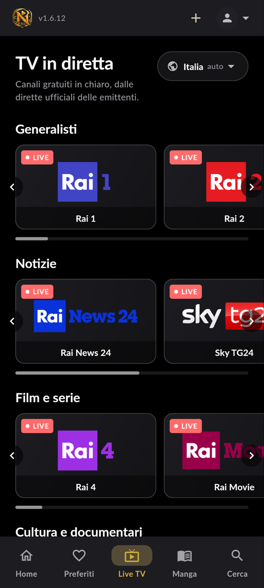

    
   
  <b>STREAMING</b>

<h3 align="center">Film, serie TV, anime, manga e TV in diretta in un'unica app. Gratis, per Windows, Android, Android TV e browser.</h3>

  
  
  
  

  
  
  

  

## Perché Nakama Streaming

Hai RaiPlay, Mediaset Infinity, Netflix, Prime Video, Crunchyroll, un sito per i manga e mille schede aperte?
Nakama Streaming li mette tutti in un'unica app, con i tuoi titoli preferiti sempre a portata di mano.

- **Tutti i tuoi servizi in un posto.** Aggiungi i siti che usi già con un tocco e li apri con il tuo abbonamento, senza cercare link.
- **Riprendi da dove eri.** Ricorda la puntata e il minuto in cui ti eri fermato. A fine puntata parte il conto alla rovescia e passa da sola alla successiva.
- **Avvisi delle uscite.** Ti avvisa quando esce una nuova puntata, un nuovo capitolo o un film che segui, anche ad app chiusa.
- **TV in diretta.** I canali gratuiti in chiaro (Rai, Mediaset, La7, notizie, film, documentari) dalle dirette ufficiali delle emittenti.
- **Manga.** Le piattaforme ufficiali in italiano e i siti dove leggi, con il segno del capitolo a cui eri arrivato.
- **Niente popup.** Il browser integrato blocca popup e pubblicità invasive dei siti.
- **Fatta per la TV.** Su Android TV si usa tutta con il telecomando.
- **Ovunque con un account, o anche senza.** Con l'account ritrovi preferiti e progressi su PC, telefono e TV. Come ospite i dati restano solo sul tuo dispositivo.
- **Gratis al 100%.** Niente abbonamenti, niente pubblicità, niente costi nascosti.

  

## Com'è

| Sul PC e sulla TV | Sul telefono |
| --- | --- |
|  |   |

## Scarica

| Dispositivo | File |
| --- | --- |
| Windows 10 e 11 | [Nakama-Streaming-Setup.exe](https://github.com/nakama-world/nakama-streaming/releases/latest/download/Nakama-Streaming-Setup.exe) |
| Android e Android TV | [Nakama-Streaming.apk](https://github.com/nakama-world/nakama-streaming/releases/latest/download/Nakama-Streaming.apk) |
| Android, versione leggera (telefoni degli ultimi anni) | [Nakama-Streaming-arm64.apk](https://github.com/nakama-world/nakama-streaming/releases/latest/download/Nakama-Streaming-arm64.apk) |
| iPhone, iPad e qualsiasi browser | [Versione web](https://nakama-streaming-92986.web.app) |

I link scaricano sempre l'ultima versione. Le versioni precedenti e le novità di ognuna sono nella pagina [Releases](https://github.com/nakama-world/nakama-streaming/releases).

## Installazione

**Windows**
1. Apri `Nakama-Streaming-Setup.exe`.
2. Se compare "Windows ha protetto il PC", premi **Ulteriori informazioni** e poi **Esegui comunque**: il programma non ha ancora una firma digitale.
3. Quando esce una versione nuova, l'app te lo dice e si aggiorna da sola.

**Telefono Android**
1. Apri il file APK scaricato.
2. Se il telefono lo chiede, permetti l'installazione da questa fonte.
3. Quando esce una versione nuova, l'app te lo dice all'avvio.

**Android TV**
1. Porta l'APK sulla TV: con una chiavetta USB, oppure con un'app per scaricare file (per esempio Downloader) usando il link "Android e Android TV" qui sopra.
2. Aprilo e permetti l'installazione da questa fonte, se la TV lo chiede.

**iPhone e iPad**
1. Apri la [versione web](https://nakama-streaming-92986.web.app) in Safari.
2. Premi Condividi e poi **Aggiungi alla schermata Home**: la trovi tra le app.

## Domande frequenti

**È davvero gratis?**
Sì, del tutto: niente abbonamenti, niente pubblicità, niente acquisti nell'app.

**Nakama Streaming contiene film o serie?**
No. Non ospita e non distribuisce video: apre i siti e i servizi che scegli tu, così come sono. Per i servizi a pagamento serve il tuo abbonamento.

**Devo creare un account?**
No. Puoi entrare come ospite. L'account (basta un nome utente e una password) serve solo per ritrovare preferiti e progressi su più dispositivi.

**Come si aggiorna?**
Da sola: all'avvio l'app controlla se c'è una versione nuova e la installa.

## In English

Nakama Streaming is a free app for Windows, Android, Android TV and the web that brings your streaming services, live TV, anime, series, films and manga together in one place. It remembers where you stopped, plays the next episode automatically and notifies you of new releases. It does not host any video: it opens the sites and services you choose. The app is in Italian.

## Contatti

Nakama Streaming è un programma di Nakama World: nakamaworldita@gmail.com
