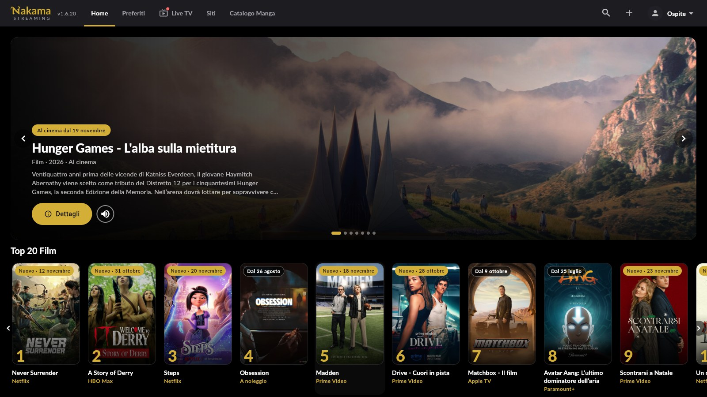
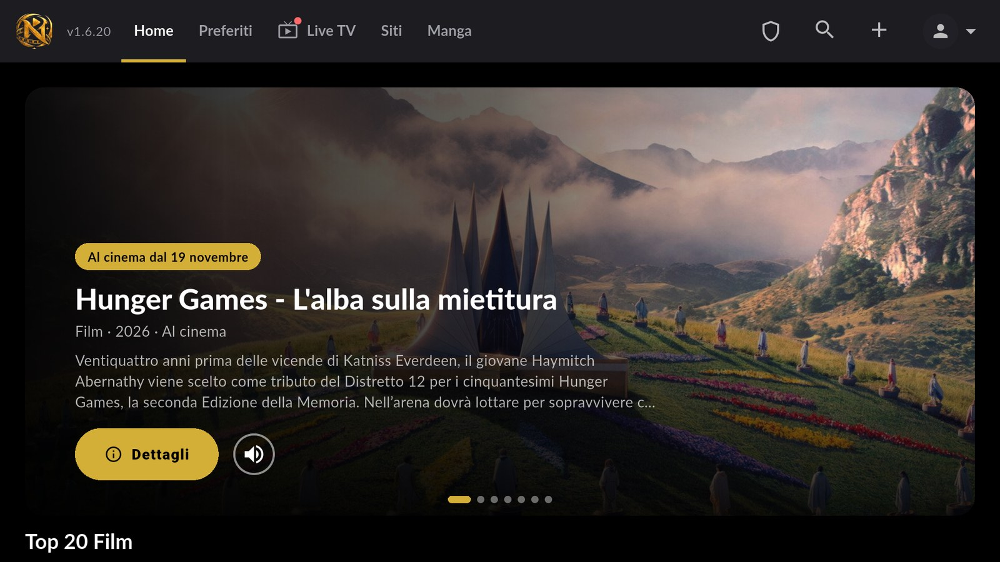
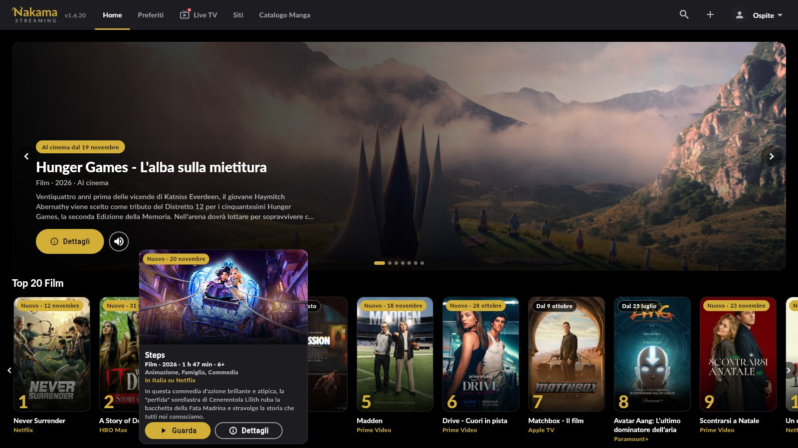
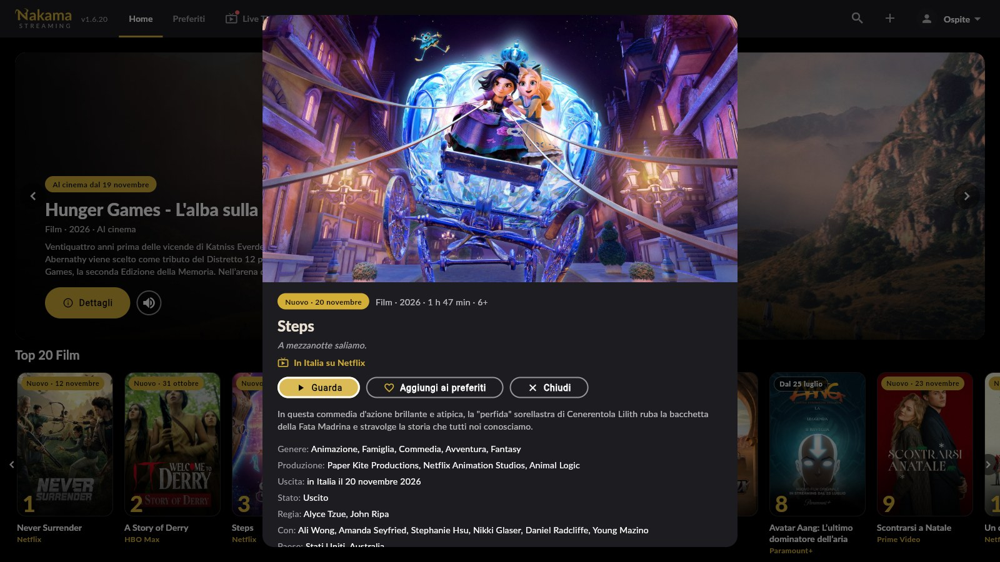
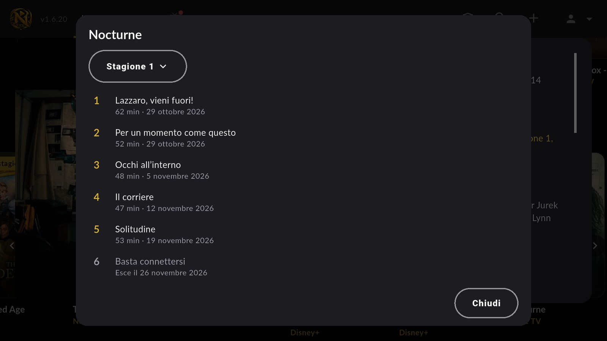
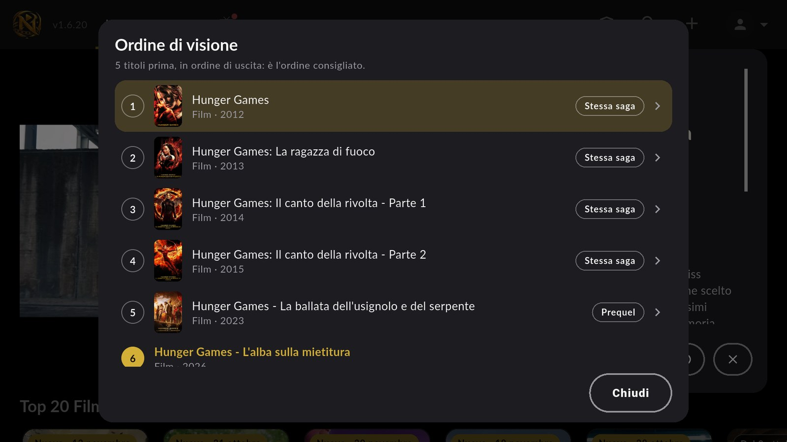
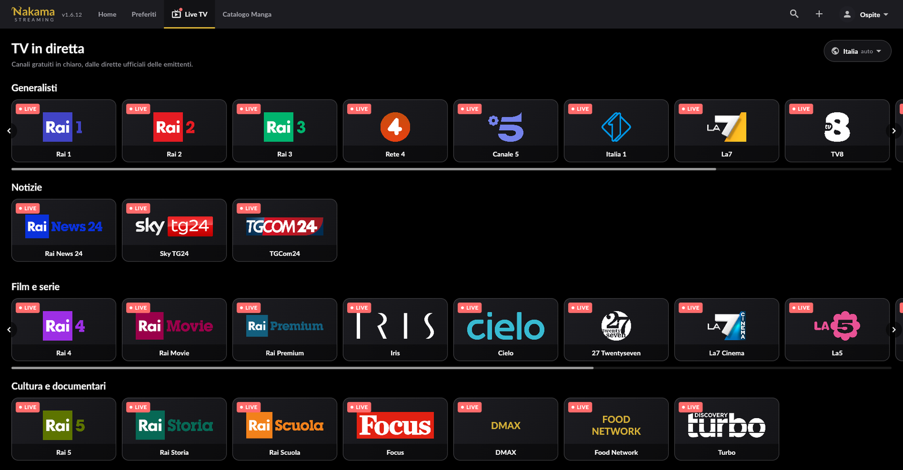
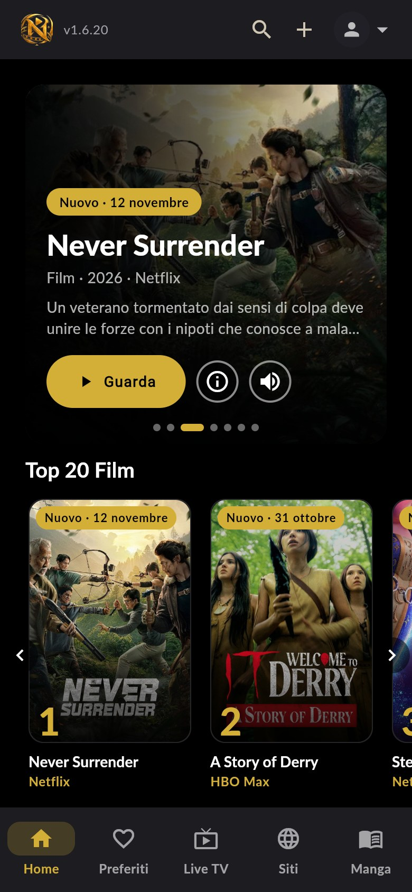
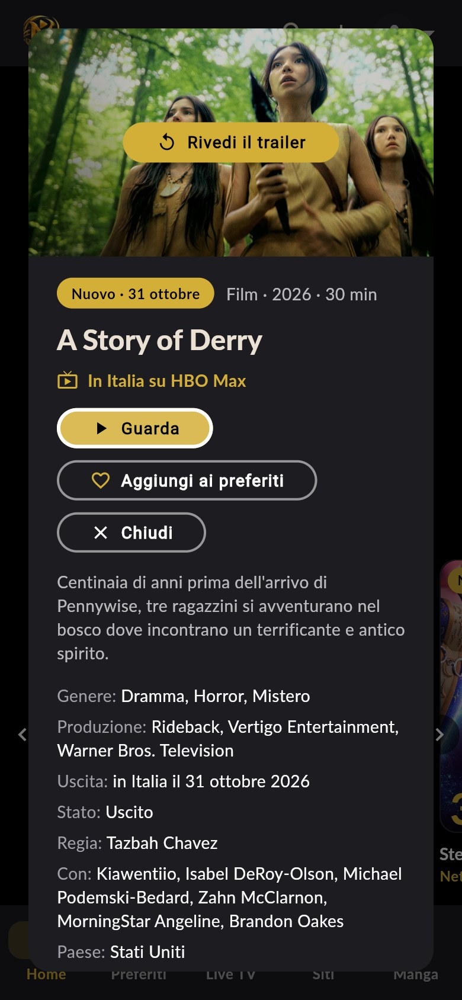

    
   
  <b>STREAMING</b>

<h3 align="center">Film, serie TV, anime, manga e TV in diretta in un'unica app. Gratis, in italiano, per Windows, Android, Android TV e browser.</h3>

  
  
  
  
  

  
  
  

  

  <a href="#cosè">Cos'è</a> ·
  <a href="#come-funziona">Come funziona</a> ·
  <a href="#cosa-ci-trovi">Cosa ci trovi</a> ·
  <a href="#scarica">Scarica</a> ·
  <a href="#installazione">Installazione</a> ·
  <a href="#domande-frequenti">Domande frequenti</a> ·
  <a href="#in-english">English</a>

## Cos'è

Hai RaiPlay, Mediaset Infinity, Netflix, Prime Video, Crunchyroll, un sito per i manga e mille schede aperte?
**Nakama Streaming li riunisce in un'unica app.** Ti dice cosa c'è di nuovo e dove vederlo in Italia, apre il servizio che scegli, ricorda la puntata e il minuto, e ti avvisa quando esce quella dopo.

Non ospita e non distribuisce video: apre i siti e i servizi che scegli tu, così come sono. Per i servizi a pagamento serve il tuo abbonamento.

## Come funziona

1. **Aggiungi i siti che usi.** Nella scheda Siti ci sono già i servizi italiani più noti: un tocco e sono tuoi. Per gli altri basta incollare il link.
2. **Guarda la Home.** Trovi le novità del momento, le Top 20, i film al cinema e le uscite di ogni piattaforma. Sotto ogni titolo c'è scritto dove si vede in Italia.
3. **Apri una scheda.** Trama, trailer, stagioni e puntate, ordine di visione, cast e chi lo distribuisce in Italia.
4. **Premi Guarda.** L'app apre il sito o il servizio giusto, con il tuo abbonamento, e blocca popup e pubblicità invasive.
5. **Riprendi quando vuoi.** Ricorda puntata e minuto su PC, telefono e TV. A fine puntata passa da sola alla successiva.
6. **Ricevi gli avvisi.** Nuova puntata, nuovo capitolo o film che segui: ti avvisa anche ad app chiusa.

## Cosa ci trovi

### Una Home come quella delle grandi piattaforme

In alto scorrono le novità con il loro trailer, in italiano quando esiste. Sotto ci sono la Top 20 dei film, delle serie e degli anime, i film **ora al cinema**, le file dedicate a ogni piattaforma, le feste e i migliori di sempre per genere.

  
  &nbsp;
  

### Una scheda che risponde alle domande

Di cosa parla, quanto dura, per che età, quando esce, chi c'è e **dove si vede in Italia**. Per le serie c'è il menu delle stagioni con le puntate e le date. Per i film con seguiti c'è **Prima e dopo**, con l'ordine giusto in cui guardarli.

  

  
  &nbsp;
  

### Le piattaforme, separate per film e serie

Netflix, Prime Video, Disney+, HBO Max, NOW e Sky, Apple TV, Paramount+, RaiPlay, Mediaset Infinity, TIMVISION, discovery+, MGM+ e MUBI. Per gli anime Crunchyroll e Anime Generation. Ogni titolo è assegnato alla sua: una serie di Disney+ resta di Disney+.

### I tuoi preferiti, in ordine

Un elenco semplice diviso in Film, Serie TV e Anime, con quello che stai guardando e a che punto sei.

### TV in diretta

I canali gratuiti in chiaro (Rai, Mediaset, La7, notizie, film, documentari) dalle dirette ufficiali delle emittenti.

  

### Manga

Le piattaforme ufficiali in italiano e i siti dove leggi, con il segno del capitolo a cui eri arrivato.

### Su tutti i tuoi schermi

Sulla TV si usa tutta col telecomando, sul PC con mouse e tastiera, sul telefono con le dita. Con un account (nome utente e password, niente altro) ritrovi siti, preferiti e progressi ovunque. Come ospite i dati restano solo sul tuo dispositivo.

  
  &nbsp;&nbsp;
  
  &nbsp;&nbsp;
  

### E in più

- **I tuoi siti restano raggiungibili.** Se un sito che hai salvato cambia indirizzo, l'app lo segue e sposta da sola i titoli che avevi salvato da lì.
- **Puntata dopo puntata.** Conto alla rovescia a fine episodio e passaggio alla stagione successiva.
- **Niente popup.** Il browser integrato ferma finestre e pubblicità invasive.
- **Si aggiorna da sola.** All'avvio controlla se c'è una versione nuova e la installa.
- **Gratis al 100%.** Niente abbonamenti, niente pubblicità, niente costi nascosti.

## Novità

Cosa è cambiato in ogni versione è nella pagina [Releases](https://github.com/nakama-world/nakama-streaming/releases).

## Scarica

| Dispositivo | File |
| --- | --- |
| Windows 10 e 11 | [Nakama-Streaming-Setup.exe](https://github.com/nakama-world/nakama-streaming/releases/latest/download/Nakama-Streaming-Setup.exe) |
| Android e Android TV | [Nakama-Streaming.apk](https://github.com/nakama-world/nakama-streaming/releases/latest/download/Nakama-Streaming.apk) |
| Android, versione leggera (telefoni degli ultimi anni) | [Nakama-Streaming-arm64.apk](https://github.com/nakama-world/nakama-streaming/releases/latest/download/Nakama-Streaming-arm64.apk) |
| iPhone, iPad e qualsiasi browser | [Versione web](https://nakama-streaming-92986.web.app) |

I link scaricano sempre l'ultima versione.

## Installazione

<b>Windows</b>

1. Apri `Nakama-Streaming-Setup.exe`.
2. Se compare "Windows ha protetto il PC", premi **Ulteriori informazioni** e poi **Esegui comunque**: il programma non ha ancora una firma digitale.
3. Quando esce una versione nuova, l'app te lo dice e si aggiorna da sola.

<b>Telefono Android</b>

1. Apri il file APK scaricato.
2. Se il telefono lo chiede, permetti l'installazione da questa fonte.
3. Quando esce una versione nuova, l'app te lo dice all'avvio.

<b>Android TV</b>

1. Porta l'APK sulla TV: con una chiavetta USB, oppure con un'app per scaricare file (per esempio Downloader) usando il link "Android e Android TV" qui sopra.
2. Aprilo e permetti l'installazione da questa fonte, se la TV lo chiede.
3. Si usa tutta col telecomando: frecce per muoverti, OK per aprire, Indietro per tornare.

<b>iPhone e iPad</b>

1. Apri la [versione web](https://nakama-streaming-92986.web.app) in Safari.
2. Premi Condividi e poi **Aggiungi alla schermata Home**: la trovi tra le app.

## Domande frequenti

<b>È davvero gratis?</b>

Sì, del tutto: niente abbonamenti, niente pubblicità, niente acquisti nell'app.

<b>Nakama Streaming contiene film o serie?</b>

No. Non ospita e non distribuisce video: apre i siti e i servizi che scegli tu, così come sono. Per i servizi a pagamento serve il tuo abbonamento.

<b>Devo creare un account?</b>

No. Puoi entrare come ospite. L'account (basta un nome utente e una password) serve solo per ritrovare siti, preferiti e progressi su più dispositivi.

<b>Che fine fanno i miei dati?</b>

Come ospite restano solo sul tuo dispositivo. Con l'account si salvano i siti, i preferiti e i punti a cui sei arrivato, per ritrovarli altrove. Non c'è pubblicità e i dati non si vendono a nessuno.

<b>Perché di un trailer sento l'inglese?</b>

Quando un trailer italiano esiste l'app usa quello. Se esiste solo l'originale, mostra i sottotitoli in italiano quando il video li ha.

<b>Su Windows compare un avviso quando la installo. È normale?</b>

Sì: il programma non ha ancora una firma digitale. Premi **Ulteriori informazioni** e poi **Esegui comunque**.

<b>Come si aggiorna?</b>

Da sola: all'avvio l'app controlla se c'è una versione nuova e la installa.

<b>Ho trovato un problema o ho un'idea</b>

Scrivi a nakamaworldita@gmail.com, oppure apri una segnalazione nella scheda [Issues](https://github.com/nakama-world/nakama-streaming/issues).

## In English

**Nakama Streaming** is a free, ad-free app for Windows, Android, Android TV and the web that brings your streaming services, live TV, films, series, anime and manga together in one place. It shows what is new and where to watch it in Italy, opens the service you choose, remembers the episode and the minute, plays the next episode by itself and notifies you of new releases. It does not host or distribute any video: it opens the sites and services you choose, and paid services need your own subscription. The app is in Italian.

## Contatti e crediti

Nakama Streaming è un programma di Nakama World: nakamaworldita@gmail.com

I dati e le immagini di film e serie vengono da TMDB. Questo prodotto usa l'API di TMDB ma non è approvato o certificato da TMDB. Marchi, locandine e titoli appartengono ai rispettivi proprietari.
